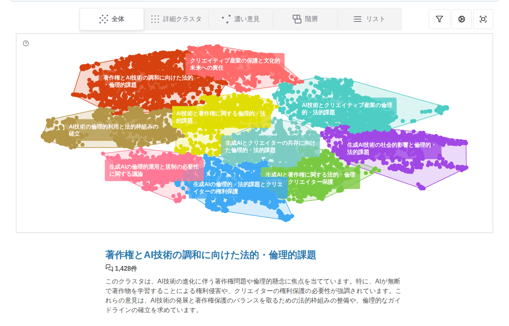
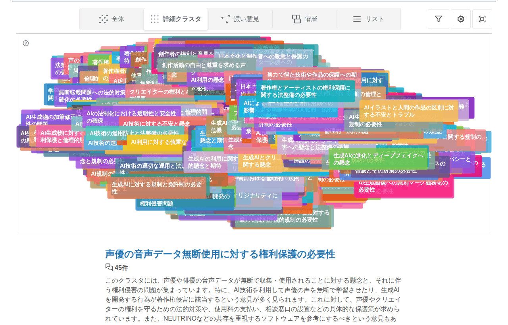
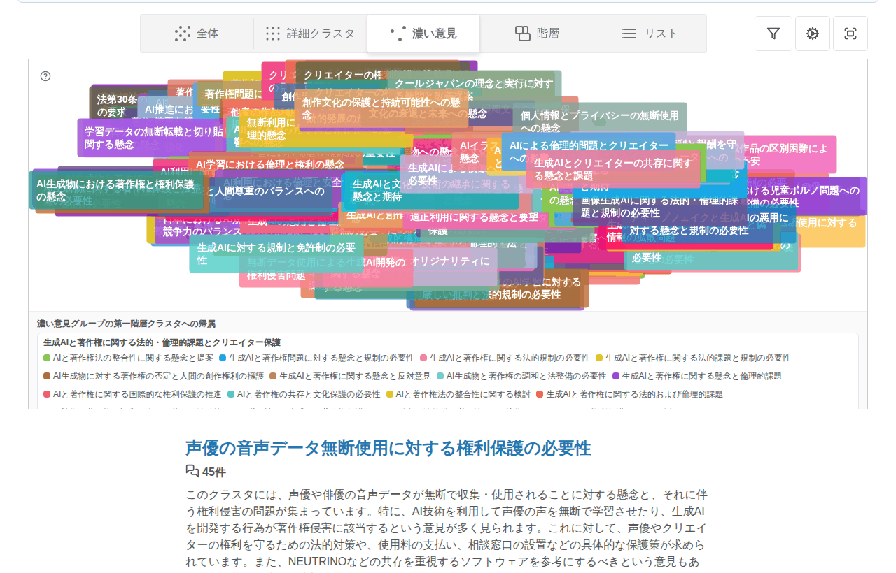
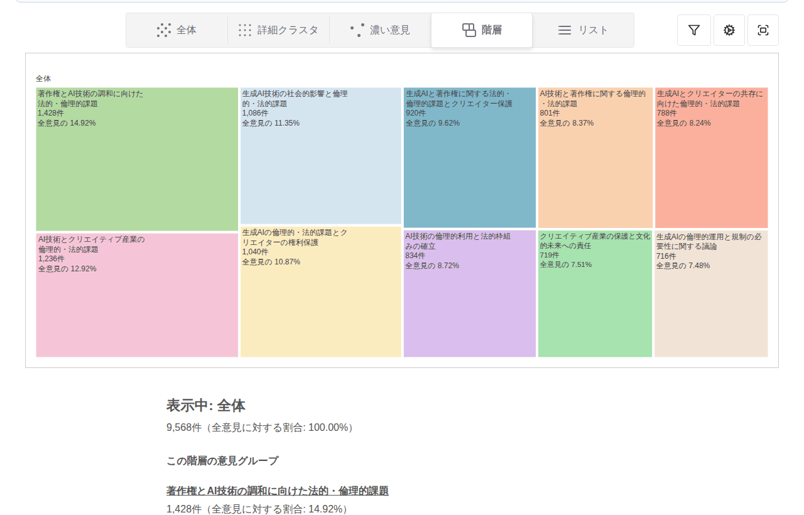
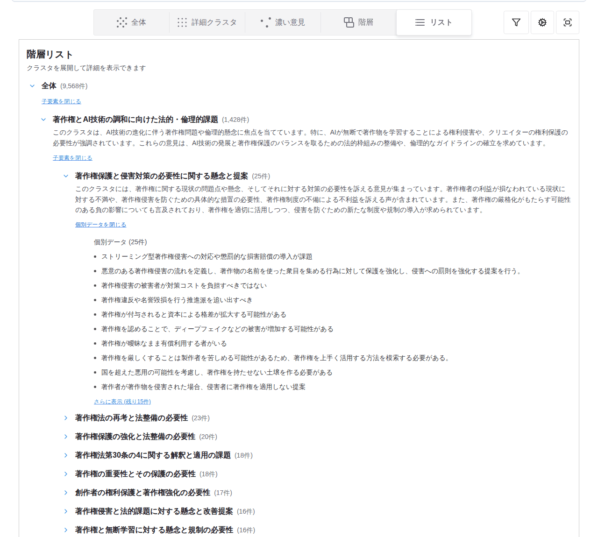

# ビューの選び方ギャラリー

**同じレポートを、すべての見方で並べたページ**です。「どの見方で読むと何が分かるか」を、実物で見比べるために置いています。読み方の考え方は [レポートの読み方 — 目的で選ぶ 5 つの見方](report-reading-guide.md#views) を、操作は [使い方](how-to-use.md#cluster-visualization) を参照してください。

ここに載せたのは、リポジトリに同梱しているテスト用レポート（`utils/dummy-server/app/reports/example/`、「AIと著作権について、どのような意見が寄せられているのか？」、意見 9,568 件・3 階層）を、公開ビューアの静的ビルド（CI の `client build` と同じ手順）で表示したものです。実データからの作り直し方は [同じ結果を手元で再現する](#reproduce) を参照してください。

| スクリーンショットの時点 | 本体のバージョン |
| --- | --- |
| 2026-10-29 | v4.2.0 以降の `main`（階層リストの「詳細モード」化 [#1159](https://github.com/digitaldemocracy2030/kouchou-ai/issues/1159) の反映前） |

## やりたいこと → 見方 {#purpose}

| やりたいこと | 見方 | この見方で分かること | 分からないこと |
| --- | --- | --- | --- |
| 全体をざっくり掴む | 全体（散布図） | 大きな話題がいくつあり、どれが大きいか。話題どうしの遠近 | 個々の意見の中身。小さな話題 |
| 細かい話題ごとに見る | 詳細クラスタ（散布図） | 大きな話題の中にどんな細かい話題があるか。似た話題の隣接 | 全部を読み切ること（点が重なる） |
| 特に似た意見が集まった所を見る | 濃い意見（散布図） | よく似た声がまとまって多く上がっている所 | 少数で散らばった意見（意図的に落とす） |
| グループの大きさを比べる | 階層図（ツリーマップ） | 入れ子の構造と、各グループの件数の比 | 意味の遠近（配置に距離の意味はない） |
| 全部読む・掘り下げる | リスト（詳細モード） | 大きな話題から順に、要約と個別の意見を 1 件ずつ。出典へのリンク | 全体の形を一目で掴むこと |

## 全体（散布図） {#scatter-all}

最上層のグループだけを散布図で表示します。まず全体像をつかむための既定の見方です。



## 詳細クラスタ（散布図） {#scatter-detail}

最下層のグループをすべて表示します。話題を細かく見たいときの見方です。



## 濃い意見（散布図） {#scatter-density}

細かいグループのうち、特に似た意見が集まったものだけに絞ります。少数の声はここには出ません。



## 階層図（ツリーマップ） {#treemap}

グループの入れ子構造を面積で表します。配置の近さに意味はありません。



## リスト（詳細モード） {#hierarchy-list}

グループを最上層から順に展開し、要約と個別の意見を 1 件ずつ読めます。最下層では、レポート作成者が出典リンクを有効にしていれば元の投稿へ辿れます。スマートフォンなど狭い画面では、この見方が最初に表示されることがあります。



## 属性で絞った見方（準備中） {#attributes}

意見 1 件ごとの属性（入力 CSV の `attribute_*` 列、[意見の分類ラベル](../development/opinion-classification.md)、賛否スコア・新規性スコア（[#1158](https://github.com/digitaldemocracy2030/kouchou-ai/issues/1158)、CLI の任意ステップ））があるレポートでは、どの見方でも属性フィルタで「賛成の意見だけ」「珍しい意見の候補だけ」のように絞れます。上のテスト用レポートには属性が無いため、属性つきの例は賛否・新規性のステップを有効にしたレポートを用意でき次第、同じ並びで追加します。

## 同じ結果を手元で再現する {#reproduce}

### テスト用レポートをそのまま見る

CI の `client build` が作る静的サイトに、同じテスト用レポートが入っています。ダウンロードと閲覧の手順は [CIの静的サイトを確認する](../development/static-preview.md) を参照してください。

### 自分のデータで全部の見方を出す

同梱のサンプル（`apps/admin/public/sample_comments.csv`、400 件）を CLI で分析すると、同じ 5 つの見方で読めるレポートになります。賛否・新規性の属性も付けるなら、次の設定を使います（`opinion_stance` は意見 1 件ごとに LLM を 1 回呼びます。`opinion_novelty` は LLM を使いません）。

```json
{
  "input": "sample_comments",
  "question": "AI の利用についてどのような意見があるか",
  "intro": "サンプルデータの分析例です。",
  "model": "gpt-4o-mini",
  "opinion_stance": { "enabled": true, "workers": 3, "target": "AI の利用を広げること" },
  "opinion_novelty": { "enabled": true, "method": "knn_distance", "k": 10 }
}
```

実行方法は [CLI クイックスタート](cli-quickstart.md) のとおりです。出力の `hierarchical_result.json` を公開ビューアで開けば、属性フィルタに `stance_score` と `novelty_score` が数値の範囲として現れます。

---

- 見方の意味と注意点: [レポートの読み方](report-reading-guide.md)
- 表示する見方の組み合わせをレポートごとに変える（`visualization_config`）: [プラグインガイド](../development/plugin-guide.md)
